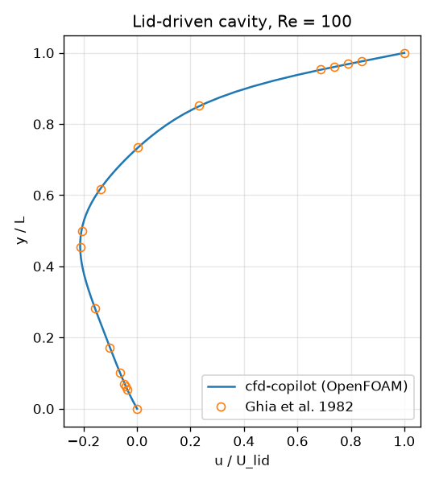

# cfd-copilot

[](https://github.com/enzozanatta-eng/cfd-copilot/actions/workflows/ci.yml)

**Describe a CFD case, get a verified OpenFOAM simulation.**

Most failed or wrong CFD results come from setup, not physics: a missing
boundary condition, a mesh too coarse for the Reynolds number, a pressure
level left undefined, a run that "finished" without converging. OpenFOAM
reports these as cryptic errors, or does not report them at all.

`cfd-copilot` puts a verification layer around OpenFOAM:

1. **Validated specs.** A case is a small YAML file. Physically inconsistent
   requests are rejected *before* anything runs, with the reason
   (for example, a mesh too coarse for the requested Reynolds number).
2. **Case generation.** The spec is turned into a complete OpenFOAM 12 case
   (mesh, fields, schemes, solver controls, sampling).
3. **Automated checks.** Every run is graded PASS / WARN / FAIL on mesh
   quality, completion, residual convergence, continuity and, where published
   data exists, agreement with a benchmark.
4. **Failure diagnosis.** Known OpenFOAM error signatures are mapped to a
   cause and a concrete fix.

5. **Plain-language requests (LLM).** `cfdc ask` turns a request into a spec.
   The model proposes, the physics checks dispose: every proposal goes through
   the same validation as a hand-written spec, and rejections are sent back to
   the model with the reason so it can correct itself.

## Quick start

Requires Python 3.10+ and [OpenFOAM 12](https://openfoam.org) (tested on Ubuntu/WSL).

```bash
git clone https://github.com/enzozanatta-eng/cfd-copilot && cd cfd-copilot
python3 -m venv .venv && source .venv/bin/activate
pip install -e ".[dev]"

source /opt/openfoam12/etc/bashrc
cfdc run examples/cavity_re100.yaml
```

```
[ OK ] mesh: checkMesh: 4096 cells, 0 failed checks
[ OK ] mesh: non-orthogonality: max 0.0 deg (warn > 65, fail > 80)
[ OK ] mesh: skewness: max 0.00 (warn > 2, fail > 4)
[ OK ] run: finished: solver reached End
[ OK ] run: convergence: residuals below 1e-05 after 283 iterations
[ OK ] run: continuity: local continuity error 8.46e-08 (warn > 1e-6, fail > 1e-4)
[ OK ] validation: Ghia 1982, Re=100: RMS error 0.0020, max 0.0053 (warn > 0.02, fail > 0.05)

Overall: PASS  (report: runs/cavity-re100/report.md)
```

The whole run (mesh, 283 SIMPLEC iterations, checks, report) takes a few
seconds on a laptop. Centreline velocity against the benchmark:

<p align="center"></p>

## Asking in plain language

```bash
pip install -e ".[llm]"
export ANTHROPIC_API_KEY=...   # or OPENAI_API_KEY=...
cfdc ask "lid-driven cavity at Re 1000, compare with the literature" --run
```

Real output (OpenAI `gpt-4.1-mini`, OpenFOAM 12):

```
Spec (1 attempt(s)):
case: lid_driven_cavity
name: cavity-re1000
reynolds: 1000.0
cells: 128
solver:
  max_iterations: 2000
  residual_target: 1.0e-05

[ OK ] mesh: checkMesh: 16384 cells, 0 failed checks
[ OK ] mesh: non-orthogonality: max 0.0 deg (warn > 65, fail > 80)
[ OK ] mesh: skewness: max 0.00 (warn > 2, fail > 4)
[ OK ] run: finished: solver reached End
[ OK ] run: convergence: residuals below 1e-05 after 660 iterations
[ OK ] run: continuity: local continuity error 1.48e-07 (warn > 1e-6, fail > 1e-4)
[ OK ] validation: Ghia 1982, Re=1000: RMS error 0.0029, max 0.0048 (warn > 0.02, fail > 0.05)

Overall: PASS  (report: runs/cavity-re1000/report.md)
```

Requests outside what the tool supports are declined instead of guessed:

```
$ cfdc ask "3D turbulent flow over a truck"
Cannot build this: Requested case is 3D turbulent flow over a truck, which is not supported.
Only 2D laminar lid-driven cavity is supported.
Closest supported case: 2D laminar lid-driven cavity
```

If a proposal is physically inconsistent (for example, a mesh too coarse for
the Reynolds number), the validator rejects it and the model gets the reason
back as a tool error, then corrects the spec. This loop is covered by the
tests with a scripted model.

The LLM sits behind a small provider-neutral `LLMClient` protocol (Anthropic
and OpenAI implementations, picked by whichever API key is set or with
`--provider`). The agent logic keeps a neutral conversation history and each
provider converts it to its own wire format, so the tests drive the agent with
a scripted fake model: no API key or network in CI.

## Commands

| Command | What it does |
|---|---|
| `cfdc ask "..." [--run]` | plain-language request -> validated spec (LLM) |
| `cfdc new --name cav --re 100 -o cav.yaml` | create a validated spec |
| `cfdc validate cav.yaml` | check a spec without running anything |
| `cfdc build cav.yaml` | write the OpenFOAM case only |
| `cfdc run cav.yaml` | build, mesh, solve, check, write `report.md` |
| `cfdc diagnose log.foamRun` | explain a failed OpenFOAM log |

Exit codes: `0` passed, `1` failed checks or run, `2` invalid spec, so runs
can gate a CI pipeline.

## Example: catching a bad request

```bash
$ cfdc new --name cav --re 1000 --cells 64
error: Value error, 64 cells per side is too coarse for Re = 1000; use at least 126.
```

## Example: diagnosing a crash

```bash
$ cfdc diagnose runs/cav/log.foamRun
Pressure level undefined
  evidence: Unable to set reference cell for field p
  cause: No boundary fixes the level of 'p' (closed domain), so the pressure equation is singular.
  fix: Add pRefCell and pRefValue (or pRefPoint) to the solver dictionary in fvSolution.
```

## Supported cases

| Case | Validation |
|---|---|
| `lid_driven_cavity` (2D, steady laminar, Re ≤ 5000) | Ghia, Ghia & Shin (1982), Re = 100, 400, 1000 |

## Design

```
spec.py        YAML spec -> validated pydantic model (physics rules live here)
cases/         one generator per case type -> OpenFOAM dictionaries
foam/dicts.py  Python dict -> OpenFOAM syntax
foam/runner.py Runner protocol (LocalRunner calls OpenFOAM; tests use a fake)
foam/logs.py   pure parsers for solver and checkMesh logs
checks.py      PASS/WARN/FAIL grading
diagnose.py    error signature -> cause + fix
pipeline.py    spec -> case -> run -> checks -> report
llm.py         provider-neutral LLMClient protocol; Anthropic and OpenAI (tool use)
ask.py         request -> proposal -> validation -> feedback loop
```

The OpenFOAM runner sits behind a protocol, so the whole pipeline is tested in
CI with recorded logs and no OpenFOAM installation.

## Roadmap

- [x] `cfdc ask "..."`: plain-language request -> spec (LLM, validated by the same rules)
- [ ] LLM explanation for failures with no matching rule
- [ ] Cylinder in cross-flow (Strouhal number vs. published data)
- [ ] Automatic mesh-independence study with GCI
- [ ] Docker image with OpenFOAM for the integration tests

## License

MIT
